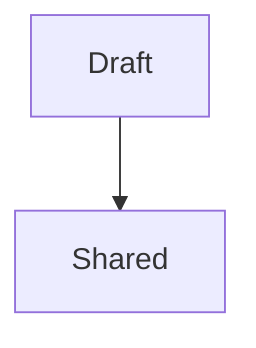

# Shared notes

Readable **bold**, _emphasis_, ~~removed text~~ and [section links](#details).

- First item
- [x] Completed task

1. Ordered item
2. Another item

> A short quotation.

## Details

| Name | Value |
| :--- | ---: |
| Unicode | Café 🚀 |
| Number | 42 |

```javascript
const message = "<safe> & readable";
```




Final paragraph.
